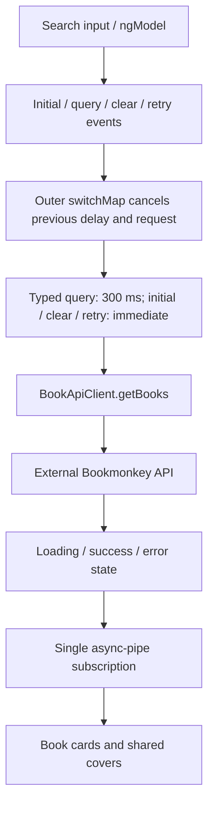

# Architecture

## Project at a glance

BookMonkey is a single Angular 20 standalone browser application for an Angular workshop. The Bookmonkey API runs separately and is not implemented in this repository. State stays local to each screen; there is no global store, cache, SSR, or repository/facade layer.

## Repository map

```text
src/
  main.ts                         Browser bootstrap
  index.html                      Host document
  styles.css                      Tailwind entry point
  environments/
    environment.ts                Production API base URL
    environment.development.ts    Local development API base URL
  app/
    app.ts / app.html / app.css    Persistent header, router outlet, footer
    app.config.ts                 Router, HTTP, API URL, error and Zone.js providers
    app.routes.ts                 Collection, detail, wildcard routes
    books/
      book.ts                     API response interface
      book-api-url.ts             API base URL injection token
      book-api-client.service.ts  HTTP requests and response selection
      book-list.component.ts      Collection state and search events
      book-list.component.html    Search, loading, error/retry, results, empty state
      book-item.component.ts      Book card and detail link
      book-cover.component.ts     Cover image and missing/failed-image fallback
      book-details.component.ts   Route-driven detail state and retry
      book-details.component.html Detail states and metadata
public/                           Static build assets
docs/                             README artwork
tests/
  book-details.spec.ts            Details browser regression suite
  book-list.spec.ts               Collection browser regression suite
  support/books.ts                Shared fixtures, URLs, API and cover mocks
tests-examples/                   TodoMVC demo, outside the default test directory
angular.json                      Browser build and development server
playwright.config.ts              Browser projects, baseURL, server startup
tsconfig*.json                    Strict application TypeScript settings
```

## Bootstrap, providers, and routing

[src/main.ts](src/main.ts) calls `bootstrapApplication(App, appConfig)`. Components are standalone with explicit template dependencies. [app.config.ts](src/app/app.config.ts) provides the router, HTTP client, API base URL, browser global error listeners, and Zone.js change detection with event coalescing.

[app.routes.ts](src/app/app.routes.ts) maps `/` to the collection and `/books/:id` to details, with the wildcard redirect last. Screens are imported eagerly. Details support direct links and refresh without requiring a loaded collection. The root App owns only persistent layout and its router outlet.

Unused NgRx, Angular Query, SSR, Express, Material, CDK, and animation dependencies were removed from the direct package declarations. The unused toast service and Material theme were removed together. Some packages, such as Express, may still appear as transitive development-tool dependencies.

## Component responsibilities

| Element              | Responsibility                                                         |
| -------------------- | ---------------------------------------------------------------------- |
| App                  | Persistent layout and router outlet                                    |
| BookListComponent    | Local query events and loading/success/error state                     |
| BookItemComponent    | Presentation of a required book input and a detail link; no HTTP       |
| BookCoverComponent   | Required URL/alternative-text inputs, image failure state and fallback |
| BookDetailsComponent | Route ID and retry events, loading/success/not-found/error state       |
| BookApiClient        | API URLs, query parameters, HTTP requests, exact-ID result selection   |
| Book                 | Compile-time representation of the API response                        |

Book-specific behavior stays inside `books/`. Shared layers or state libraries should be added only when a concrete feature requires them.

## Collection data flow and state



The list loads immediately using the API client's default limit of 10. The old public `pageSize` input had no callers and was removed instead of exposing a setting that did not reload on changes.

The draft `searchTerm` is separate from the query captured in each state. Every change immediately enters an outer `switchMap`, cancelling both a pending RxJS timer and an in-flight request. Nonempty typed queries wait 300 ms; clearing, initial loading, and retry request immediately. Consecutive identical queries are suppressed, while explicit retries bypass that suppression.

Every accepted event first emits loading and removes previous results. Only successful empty arrays show an empty message. Failures show an inline alert and retry for the failed query. Error handling stays inside the request branch, allowing later input to recover. A single async pipe owns the entire stream and disposes its timer and HTTP subscription when the screen is destroyed.

Items are tracked by ID. Search input has a label, interactive controls have visible focus styling, and loading/empty states expose status semantics. Search is not stored in the URL or persisted; returning from details resets the collection.

## Details and cover state

Details combine route-ID changes and retry events using `switchMap`. Superseded requests are cancelled, loading clears stale content immediately, and the single async pipe handles subscription cleanup. Empty matches and HTTP 404 responses produce not-found; other failures offer retry. Every state offers back-navigation.

Both screens use [BookCoverComponent](src/app/books/book-cover.component.ts). It renders a placeholder for missing or failed images and resets failure state when its URL input changes. The details loading branch destroys its success view, so subsequent success creates a fresh cover. Request pipelines do not manage cover flags.

Abstracts render through text interpolation with preserved line breaks. Prices retain the API's string value without an inferred currency. Each screen supplies its own single page heading; the app-shell brand is a paragraph.

## Backend boundary and deployment configuration

[BookApiClient](src/app/books/book-api-client.service.ts) injects [BOOK_API_BASE_URL](src/app/books/book-api-url.ts), strips a trailing slash, and appends `/books`. Its methods are `getBooks(pageSize = 10, searchTerm?)` and `getBook(id): Observable<Book>`:

```text
GET <base>/books?_limit=10
GET <base>/books?_limit=10&q=<search term>
GET <base>/books?id=<encoded book ID>
```

[app.config.ts](src/app/app.config.ts) supplies the token from the selected environment. Development replaces [environment.ts](src/environments/environment.ts) with [environment.development.ts](src/environments/environment.development.ts), using `http://localhost:4730`. Production defaults to same-origin `/api`, so the deployment must reverse-proxy `/api/books` to the external backend's `/books`, stripping the `/api` prefix, or change the production base URL before building. This repository does not provide that reverse proxy. For a cross-origin URL, the backend must allow the frontend origin through CORS. There is no authentication or interceptor.

The backend's single-resource `/books/:isbn` endpoint accepts ISBN rather than the model's ID. Detail lookup intentionally requests the ID-filtered collection, selects the exact ID match, and raises an HTTP 404 error when absent. `HttpParams` encodes query values. The frontend route remains `/books/:id`.

`_limit` controls result count; there is no pagination UI or offset. The backend determines `q` search semantics. [Book](src/app/books/book.ts) represents the response directly, including string IDs and prices, an optional subtitle, and numeric page counts/user IDs. HTTP generics provide compile-time typing, not runtime validation.

## Styling, build, and tests

Tailwind CSS 4 supplies application styling through [src/styles.css](src/styles.css) and `.postcssrc.json`. The root, collection, and details use external templates; the smaller card and cover use inline templates. Material styles and unused Google Fonts links are no longer loaded. Builds do not need to fetch those stylesheets.

The declared toolchain is Angular 20.2, TypeScript 5.9, and RxJS 7.8. [tsconfig.json](tsconfig.json) preserves strict TypeScript and template checks. Production builds use bundle budgets and output hashing; development enables source maps and disables optimization. Public assets are copied to the output. There is no CI pipeline in the repository.

| Command                                | Purpose                                        |
| -------------------------------------- | ---------------------------------------------- |
| `npm install`                          | Install dependencies                           |
| `npm start`                            | Serve development frontend at localhost:4200   |
| `npx bookmonkey-api`                   | Run the separate backend at localhost:4730     |
| `npm run build`                        | Production build using the /api endpoint       |
| `npm run watch`                        | Development build in watch mode                |
| `npx playwright install`               | Install Chromium, Firefox, and WebKit binaries |
| `npm test` or `npm run test:e2e`       | Run application browser regression suites      |
| `npm test -- --project=chromium`       | Run only Chromium                              |
| `npx prettier --check <changed-files>` | Check explicit changed paths                   |

Playwright starts a dedicated frontend server at localhost:4202 and supplies a baseURL. It refuses to reuse an existing server so stale application code cannot silently pass the suite. API and cover requests are mocked before navigation; tests do not require the live backend or external websites. Shared fixtures/mocks live in `tests/support/books.ts`. The external Playwright starter suite was removed; the TodoMVC demo remains outside the configured `tests/` directory.

The collection suite covers failure/retry/recovery, successful empty states, keyboard names and focus, debounce/clear behavior, immediate request cancellation, stale results, destruction cleanup, and cover fallbacks. Controlled response promises and Playwright's browser clock avoid fixed sleeps. Details coverage retains direct links/refresh, metadata, literal text, missing content, broken covers, loading, not-found, retry, encoded IDs, route cancellation, and mobile/desktop layout.

For production-configuration coverage, set `BOOKMONKEY_TEST_PRODUCTION=1` before running Playwright. The server uses the production configuration at localhost:4201, and mocks target same-origin `/api/books`. This checks both collection and detail URL construction against the alternate configured provider without a live reverse proxy. Unset the variable afterward. See README for PowerShell commands.

The incomplete Karma target and Jasmine tsconfig were removed. `npm test` now runs actual browser coverage; no Angular unit-test runner is configured.

## Current limits and extension points

- Search state resets on navigation; there is no shared cache or persisted query.
- API data is trusted at runtime. Introduce boundary validation only if the external contract requires it.
- There are no create, edit, delete, authentication, or pagination workflows.
- Mocked tests verify frontend behavior and configured URLs, not a live backend or production reverse proxy.

Start with `main.ts`, `app.config.ts`, and `app.routes.ts`, then follow each screen into the API client and presentation components. Keep HTTP details in the client and screen state local. Update this guide when changing routes, responsibilities, state, API contracts, or test setup.
