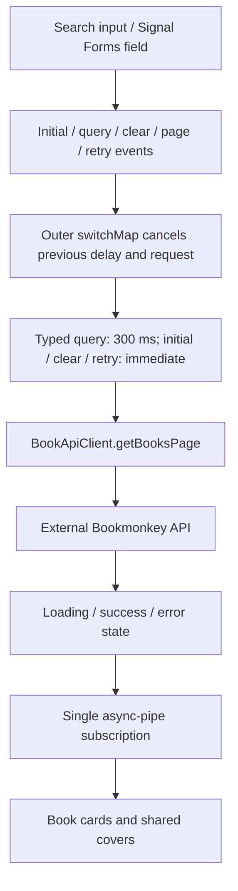

# Architecture

## Project at a glance

BookMonkey is a single Angular 21 standalone browser application for an Angular workshop. The Bookmonkey API runs separately and is not implemented in this repository. Book state stays local to each screen; the persistent header owns the app-wide theme preference. There is no global store, cache, SSR, or repository/facade layer.

## Repository map

```text
src/
  main.ts                         Browser bootstrap
  index.html                      Host document
  styles.css                      Tailwind entry point
  environments/
    environment.ts                Production API base URL
    environment.development.ts    Local development API base URL
  app/
    app.ts / app.html / app.css    Persistent header, router outlet, footer
    app.config.ts                 Router, HTTP, API URL, error and Zone.js providers
    app.routes.ts                 Collection, creation, detail, wildcard routes
    theme-control.component.ts    System/light/dark preference and document theme
    books/
      book.ts                     API response interface
      book-changes.ts             Editable fields and numeric write-price type
      book-draft.ts               Creation fields including user-entered ISBN
      book-page.ts                Page results and forward-navigation availability
      book-api-url.ts             API base URL injection token
      book-api-client.service.ts  HTTP requests and response selection
      book-list.component.ts      Collection state and search events
      book-list.component.html    Search, loading, error/retry, results, empty state
      book-item.component.ts      Book card and detail link
      book-cover.component.ts     Cover image and missing/failed-image fallback
      book-details.component.ts   Route-driven detail state and retry
      book-details.component.html Detail states and metadata
      book-edit.component.ts      Shared-form wrapper and lifetime-bound update
      book-form.component.ts      Shared creation/editing form and validation
      book-form.component.html    Accessible fields and save/cancel feedback
      book-create.component.ts    Creation request and navigation to returned ID
public/                           Static build assets
docs/                             README artwork
tests/
  book-details.spec.ts            Details browser regression suite
  book-edit.spec.ts               Editing, validation, persistence and retry coverage
  book-create.spec.ts             Creation, validation, duplicate ISBN and retry coverage
  book-pagination.spec.ts         Page navigation, search reset, boundaries and cancellation
  book-list.spec.ts               Collection browser regression suite
  theme.spec.ts                   Theme behavior, persistence, and keyboard coverage
  support/books.ts                Shared fixtures, URLs, API and cover mocks
tests-examples/                   TodoMVC demo, outside the default test directory
angular.json                      Browser build and development server
playwright.config.ts              Browser projects, baseURL, server startup
tsconfig*.json                    Strict application TypeScript settings
```

## Bootstrap, providers, and routing

[src/main.ts](src/main.ts) calls `bootstrapApplication(App, appConfig)`. Components are standalone with explicit template dependencies and `OnPush` change detection. Required presentation inputs use `input.required()`, services use `inject()`, and templates use native control flow. [app.config.ts](src/app/app.config.ts) provides the router, HTTP client, API base URL, browser global error listeners, and Zone.js change detection with event coalescing.

[app.routes.ts](src/app/app.routes.ts) maps `/` to the collection, `/books/new` to creation and `/books/:id` to details, with
the wildcard redirect last. The static creation route precedes the ID route. All screens are lazy-loaded with
`loadComponent`. Details support direct links and refresh without requiring a loaded collection. The root App owns only
persistent layout and its router outlet.

Unused NgRx, Angular Query, SSR, Express, Material, CDK, and animation dependencies were removed from the direct package declarations. The unused toast service and Material theme were removed together. Some packages, such as Express, may still appear as transitive development-tool dependencies.

## Component responsibilities

| Element               | Responsibility                                                          |
| --------------------- | ----------------------------------------------------------------------- |
| App                   | Persistent layout and router outlet                                     |
| ThemeControlComponent | Header selection, saved preference, device changes, document appearance |
| BookListComponent     | Local query/page events and loading/success/error state                 |
| BookItemComponent     | Presentation of a required book input and a detail link; no HTTP        |
| BookCoverComponent    | Required URL/alternative-text inputs, image failure state and fallback  |
| BookDetailsComponent  | Route ID and retry events, loading/success/not-found/error state        |
| BookFormComponent     | Shared typed fields, validation and submitted/cancelled outputs         |
| BookEditComponent     | Existing-book save/error state and save/cancel outputs                  |
| BookCreateComponent   | New-book save/error state and navigation using the returned ID          |
| BookApiClient         | API URLs, query parameters, HTTP requests, exact-ID result selection    |
| Book                  | Compile-time representation of the API response                         |

Book-specific behavior stays inside `books/`. Shared layers or state libraries should be added only when a concrete feature requires them.

## Collection data flow and state



The list loads page one immediately, with a fixed size of ten books. Previous/Next controls and the current page appear
below successful results, including empty results. Previous is disabled on page one; Next is disabled when the API's
filtered total count shows no following page. `getBooksPage` reads `X-Total-Count`; if the header is missing or invalid, a
full ten-book response allows another page. The API exposes the count header through CORS. There is no page-size selector.

A Signal Forms model holds the search draft separately from the query and page captured in each state. The
`FormField` directive binds the input to its field; native input events synchronously dispatch search requests into the
same stream as page-navigation and explicit retry events. Clearing updates the field and dispatches immediately.
Changing or clearing the search resets to page one;
page navigation retains the active query and retry retains both the failed query and page. Every accepted event enters an
outer `switchMap` immediately, cancelling both a pending RxJS timer and an in-flight request. Nonempty typed queries wait
300 ms; clearing, initial loading, page navigation and retry request immediately. Consecutive identical query/page pairs
are suppressed, while explicit retries bypass that suppression.

Every accepted event first emits loading and removes previous results. Only successful empty arrays show an empty message. Failures show an inline alert and retry for the failed query. Error handling stays inside the request branch, allowing later input to recover. A single async pipe owns the entire stream and disposes its timer and HTTP subscription when the screen is destroyed.

Items are tracked by ID. Search input has a label, interactive controls have visible focus styling, and loading/empty states
expose status semantics. The heading area offers an Add book link before the search input in keyboard order. Search and
page are not stored in the URL or persisted; returning from details resets the collection to page one without a search.

## Details and cover state

Details combine route-ID changes and retry events using `switchMap`. Superseded requests are cancelled, loading clears stale content immediately, and the single async pipe handles subscription cleanup. Empty matches and HTTP 404 responses produce not-found; other failures offer retry. Every state offers back-navigation.

Both screens use [BookCoverComponent](src/app/books/book-cover.component.ts). It renders a placeholder for missing or failed images and uses `linkedSignal` to reset failure state when its URL signal input changes. Covers use dynamic API URLs and ordinary image bindings. The details loading branch destroys its success view, so subsequent success creates a fresh cover. Request pipelines do not manage cover flags.

Abstracts render through text interpolation with preserved line breaks. Prices retain the API's string value without an inferred currency. Each screen supplies its own single page heading; the app-shell brand is a paragraph.

## Editing books

The details success view offers an **Edit book** button. It replaces the article with
[BookEditComponent](src/app/books/book-edit.component.ts) at the same `/books/:id` URL; no new route or shared state is needed.
The editor uses [BookFormComponent](src/app/books/book-form.component.ts), which initializes a typed Signal Forms model with
title, subtitle, author, publisher, page count, price, cover URL and
description. ISBN is displayed as immutable text, and technical IDs are not exposed as fields. Title and author must
contain text; pages are required and must be a nonnegative integer. Price is optional and must be nonnegative when present.
Inputs use `FormField` bindings with labels, field-associated validation messages, responsive layout and light/dark styling.
The schema applies required/non-whitespace text checks, minimum numeric values and a whole-number page check.
`FormRoot` marks fields touched on submission and emits a draft only when valid. Empty numeric inputs remain `null`;
submission converts an empty optional price to `undefined`. The saving input disables the form through schema logic.
Signal Forms (`@angular/forms/signals`) is experimental in Angular 21.2; future Angular updates may require API changes.

Save calls `BookApiClient.updateBook` using the existing book and editable changes. It sends `PUT <base>/books/:isbn`,
encoding the ISBN and excluding the response ID from the body. The existing resource fields are retained, including ISBN
and user ID; only editable fields are replaced. This full replacement allows a cleared optional price to be omitted instead
of retaining its old value as a PATCH would. Empty optional text fields are sent as empty strings. The write price is
numeric, matching the inspected, locally cached Bookmonkey API 5.0.1 schema; existing read-price strings remain accepted by
the editor and no currency is inferred. This repository's read model does not describe every field of that API version.

During a save the form and action buttons are disabled, and a saving status is announced. A failure keeps the draft intact,
shows an alert and enables another save. Success destroys the editor and reloads the details through their existing retry
stream. Cancel destroys the draft without a write and restores the original details. A route-ID change clears editing state
and destroys the editor; its save subscription uses `takeUntilDestroyed` so a late response cannot overwrite another screen.
Cancelling a browser request cannot undo a write already accepted by the backend.

## Creating books

The collection's Add book link opens `/books/new`. [BookCreateComponent](src/app/books/book-create.component.ts) uses the
same form and validation as editing, initialized with empty fields. Creation additionally exposes a required ISBN input;
no checksum or length restriction is inferred. No technical ID or user identity is entered or fabricated.

Valid submission calls `BookApiClient.createBook` with `POST <base>/books`. The inspected API returns status 201 and the
created resource with its generated ID; the application opens `/books/:id` using that returned ID, not the ISBN. Cancel
returns to the collection without a write. Saving prevents duplicate submissions. A failed request retains the draft and
allows retry; status 409 displays duplicate-ISBN feedback so the user can correct that field. The shared form retains the
editing screen's labels, error associations, numeric rules, theme styling and responsive layout. Both save wrappers tie
subscriptions to their component lifetime.

## Backend boundary and deployment configuration

[BookApiClient](src/app/books/book-api-client.service.ts) injects [BOOK_API_BASE_URL](src/app/books/book-api-url.ts), strips a
trailing slash and appends `/books`. The collection uses `getBooksPage(page, searchTerm?): Observable<BookPage>`, while details
use `getBook(id): Observable<Book>`. The older `getBooks(pageSize = 10, searchTerm?)` array-returning method remains available:

```text
GET <base>/books?_limit=10
GET <base>/books?_limit=10&q=<search term>
GET <base>/books?_limit=10&_page=<1-based page>&q=<optional search term>
GET <base>/books?id=<encoded book ID>
POST <base>/books
PUT <base>/books/<encoded ISBN>
```

[app.config.ts](src/app/app.config.ts) supplies the token from the selected environment. Development replaces [environment.ts](src/environments/environment.ts) with [environment.development.ts](src/environments/environment.development.ts), using `http://localhost:4730`. Production defaults to same-origin `/api`, so the deployment must reverse-proxy `/api/books` to the external backend's `/books`, stripping the `/api` prefix, or change the production base URL before building. This repository does not provide that reverse proxy. For a cross-origin URL, the backend must allow the frontend origin through CORS. There is no authentication or interceptor.

The backend's single-resource `/books/:isbn` endpoint accepts ISBN rather than the model's ID. Detail lookup intentionally requests the ID-filtered collection, selects the exact ID match, and raises an HTTP 404 error when absent. `HttpParams` encodes query values. The frontend route remains `/books/:id`.

`_limit` controls page size and `_page` selects a one-based page. The backend applies `q` filtering before pagination and
provides the filtered total in `X-Total-Count`; it determines search semantics. [Book](src/app/books/book.ts) is the existing
response interface, including string IDs and prices, an optional subtitle and numeric page counts/user IDs. The inspected
API 5.0.1 additionally has optional fields and numeric prices; write models use a numeric optional price and do not invent
those unexposed fields. HTTP generics provide compile-time typing, not runtime validation.

## Styling, build, and tests

Tailwind CSS 4 supplies application styling through [src/styles.css](src/styles.css) and `.postcssrc.json`. The root, collection, and details use external templates; the smaller card and cover use inline templates. Material styles and unused Google Fonts links are no longer loaded. Builds do not need to fetch those stylesheets.

[ThemeControlComponent](src/app/theme-control.component.ts) provides a labeled native System / Light / Dark selector in the persistent header. System is the default and follows `prefers-color-scheme`, including changes while the app is open. Manual choices override device changes. The selected preference is saved as `bookmonkey-theme` in browser `localStorage`; missing, invalid, or inaccessible saved values fall back to System. If storage writes are blocked, selection still works for the current session. The device listener is removed when the component is destroyed.

The component stores the preference and device appearance in signals, derives the resolved appearance with `computed()`, and applies the `dark` class and native `color-scheme` to the document root through a component-lifetime effect. Tailwind's custom `dark` variant follows that class, allowing a manual light override even when the device is dark. Root colors and dark utilities cover the header, footer, collection, detail cards, covers, controls, and loading/empty/error states. Theme state requires no backend changes or shared state library.

The declared toolchain is Angular 21.2, TypeScript 5.9, and RxJS 7.8. [tsconfig.json](tsconfig.json) preserves strict TypeScript and template checks. Production builds use bundle budgets and output hashing; development enables source maps and disables optimization. Public assets are copied to the output. There is no application build or test CI pipeline in the repository.

[The issue-analysis workflow](.github/workflows/issue-analysis.yml) creates a dedicated Codex home in the runner's temporary directory and writes a `github-issues` permission profile to its `config.toml`. The profile extends `:workspace` and enables the network proxy with access to `api.github.com`. The action selects that profile with `drop-sudo`, using the configured OpenAI API key secret for Codex and the built-in GitHub token as `GH_TOKEN` with `issues: write`. The `clarify-feature` skill reads the issue and comments through GitHub CLI, assesses suitable labels against the repository's current label catalog, and adds missing matches while preserving existing labels. It reuses matching labels and creates missing reusable labels with descriptions and colors when needed; it does not remove labels. It maintains unresolved clarification questions or a requirements story in one analysis comment, identified by the hidden marker `<!-- clarify-feature:analysis -->` and publishing author. Later runs update that comment by ID; a clearly identifiable older analysis comment can be migrated by adding the marker. Unrelated comments remain untouched. Publication and label additions are verified separately. Issue openings, edits, and human comments trigger analysis; bot comments and pull-request comments are excluded. This workflow does not implement features or change issue bodies or state.

| Command                                | Purpose                                        |
| -------------------------------------- | ---------------------------------------------- |
| `npm install`                          | Install dependencies                           |
| `npm start`                            | Serve development frontend at localhost:4200   |
| `npx bookmonkey-api`                   | Run the separate backend at localhost:4730     |
| `npm run build`                        | Production build using the /api endpoint       |
| `npm run watch`                        | Development build in watch mode                |
| `npx playwright install`               | Install Chromium, Firefox, and WebKit binaries |
| `npm test` or `npm run test:e2e`       | Run application browser regression suites      |
| `npm test -- --project=chromium`       | Run only Chromium                              |
| `npx prettier --check <changed-files>` | Check explicit changed paths                   |

Playwright starts a dedicated frontend server at localhost:4202 and supplies a baseURL. It refuses to reuse an existing server so stale application code cannot silently pass the suite. API and cover requests are mocked before navigation; tests do not require the live backend or external websites. Shared fixtures/mocks live in `tests/support/books.ts`. The external Playwright starter suite was removed; the TodoMVC demo remains outside the configured `tests/` directory.

The collection suite covers failure/retry/recovery, successful empty states, keyboard names and focus, debounce/clear behavior, immediate request cancellation, stale results, destruction cleanup, and cover fallbacks. Controlled response promises and Playwright's browser clock avoid fixed sleeps. Details coverage retains direct links/refresh, metadata, literal text, missing content, broken covers, loading, not-found, retry, encoded IDs, route cancellation, and mobile/desktop layout.

The editing suite covers keyboard entry, all prefilled editable fields, ISBN/ID protection, saving and persistence across
reload, optional-field clearing, cancellation, required fields, nonnegative numeric values, and save failure/retry with draft
retention. Its per-test stateful mock distinguishes ID-filtered reads from ISBN-based PUT/PATCH writes. Backend schema and
durability are not verified by mocked browser tests.

Creation coverage exercises empty forms, all-field and required-only submissions, generated-ID navigation and reload,
cancel, validation, retry and duplicate ISBN correction. Signal Forms regression cases cover whitespace-only required
text, untouched-field errors on submission, fractional pages versus prices, and disabled fields/actions during a pending
save with draft restoration after failure. Pagination coverage exercises fixed-size pages, boundaries,
paginated searches, reset on query change/clear, retry of the same page/query and immediate cancellation of stale requests.
The collection keyboard test includes the new Add book stop while retaining its search and clear-control focus checks.

The theme suite covers both device appearances, live device changes, manual overrides, returning to System, persistence across refresh and a new browser context restored from real saved storage, keyboard selection, and dark loading/empty/error states on both routes. It checks rendered backgrounds rather than relying on a particular CSS class. These automated checks do not constitute a complete visual contrast audit.

For production-configuration coverage, set `BOOKMONKEY_TEST_PRODUCTION=1` before running Playwright. The server uses the production configuration at localhost:4201, and mocks target same-origin `/api/books`. This checks both collection and detail URL construction against the alternate configured provider without a live reverse proxy. Unset the variable afterward. See README for PowerShell commands.

The incomplete Karma target and Jasmine tsconfig were removed. `npm test` now runs actual browser coverage; no Angular unit-test runner is configured.

## Local Angular MCP server

[tools/angular-mcp/index.ts](tools/angular-mcp/index.ts) registers the custom stdio MCP server configured in
[.codex/config.toml](.codex/config.toml). Build it with `npm run build.angular-mcp`; restart the connection after
changes. Protocol output uses stdout, while startup diagnostics use stderr.

The `run_migration` tool delegates to [migrations.ts](tools/angular-mcp/migrations.ts). Its discriminated input
selects `code` (`ng generate @angular/core:<migration>`) or `version` (`ng update <package> --migrate-only`).
Code migrations accept a workspace-relative path, a dry run, and an optional standalone phase. Version migrations
accept an installed package, starting and optional target version, optional migration name, and explicit dirty-tree
opt-in. They do not install or upgrade dependencies. Available code migrations match the installed Angular 21 CLI.

The migration runner invokes the local CLI JavaScript entry point with Node and an argument array, without a shell
or automatic CLI download (`NG_DISABLE_VERSION_CHECK=true`). It runs from the workspace root, disables interactive prompts and analytics, limits execution
to ten minutes and output to 10 MiB, and returns stdout/stderr with `isError` on failure. A failed migration can leave
partial changes; the tool does not reset files. Both custom tools use the existing per-tool approval configuration.

[migrations.test.cjs](tools/angular-mcp/migrations.test.cjs) checks argument forwarding, input rejection, CLI failures,
a real control-flow preview/application, a version-migration CLI invocation with no pending migrations in an isolated
workspace, and tool discovery/validation over stdio. Run it after compiling the MCP server. Version migration execution
depends on the installed package's migrations; tests do not apply version migrations to this application.

## Automatic CI fixes

[Auto-fix](.github/workflows/auto-fix.yml) handles failed `Deploy to GitHub Pages` runs from the same repository.
It checks out the failed SHA, configures the Git bot identity, and creates `auto-fix/{run-id}-{attempt}`.
Codex commits the repair locally and writes an uncommitted explanation to ignored `tmp/auto-fix-summary.md`.
The workflow independently runs `npm run build` before publishing. It requires a clean working tree, preservation
of the starting commit, a nonempty repair diff, and a nonempty explanation. It checks the source branch still points
to the failed SHA before pushing a new branch without force and creating a PR targeting that source branch.
The PR body includes the explanation, successful build check, failed-run URL, and starting SHA; its URL is recorded
in the Actions summary. Fork runs, empty repairs, and stale source branches do not publish a PR. Failures use the
existing notification job with `issues: write`. Creating PRs also requires the repository's Actions PR setting.

## Current limits and extension points

- Search/page state resets on navigation; there is no shared cache or persisted query.
- API data is trusted at runtime. Introduce boundary validation only if the external contract requires it.
- There are no delete or authentication workflows.
- Mocked tests verify frontend behavior and configured URLs, not a live backend or production reverse proxy.

Start with `main.ts`, `app.config.ts`, and `app.routes.ts`, then follow each screen into the API client and presentation components. Keep HTTP details in the client and screen state local. Update this guide when changing routes, responsibilities, state, API contracts, or test setup.
