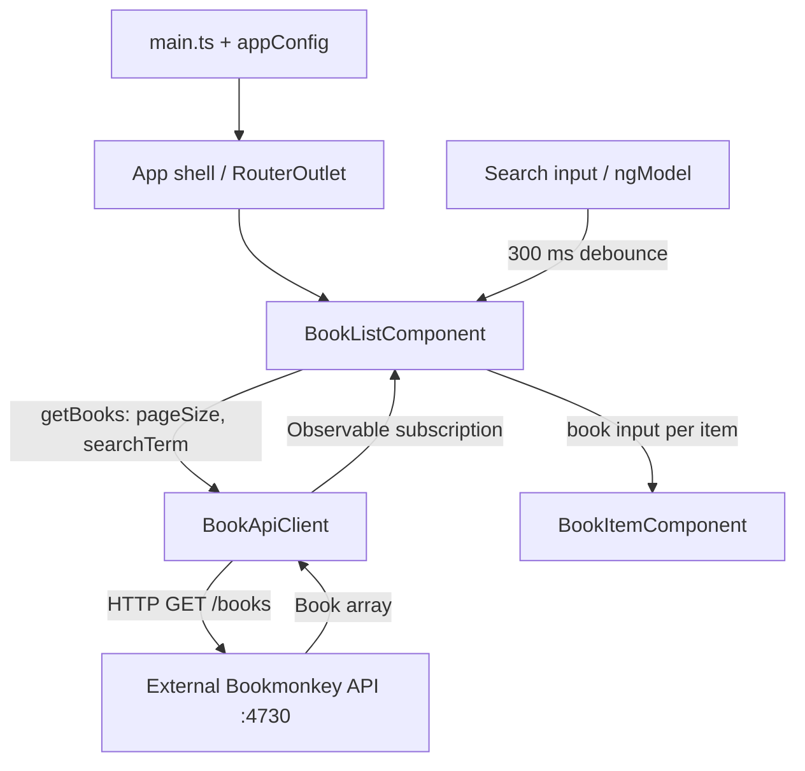

# Architecture

## Project at a glance

BookMonkey is a small Angular workshop application for browsing and searching a book collection. This repository contains a single Angular application, not a multi-project workspace. The backend is the separately started Bookmonkey API; its implementation is not part of this repository.

The current architecture is deliberately small: an application shell hosts a routed feature, a container component owns screen state, a presentation component renders each book, and an injectable API client handles HTTP access. There are no NgModules, global state store, or additional application layers in the current source.

## Repository map

```text
src/
  main.ts                         Browser bootstrap
  index.html                      Host document
  styles.css                      Tailwind entry point
  material-theme.scss             Material snack-bar style overrides
  app/
    app.ts / app.html / app.css    Root shell: header, router outlet, footer
    app.config.ts                 Application-wide providers
    app.routes.ts                 Route definitions
    books/                        Book feature: UI, model, and data access
      book.ts
      book-api-client.service.ts
      book-list.component.ts
      book-item.component.ts
      book-details.component.ts
    shared/
      toast.service.ts            Reusable notification service
public/                           Static files copied into the build
docs/                             README artwork
tests/                            Playwright starter tests
tests-examples/                   Additional Playwright demo tests
angular.json                      Build, development server, and test targets
playwright.config.ts              Browser test configuration
tsconfig*.json                    Application and test TypeScript settings
```

## Bootstrap, dependency injection, and routing

[src/main.ts](src/main.ts) calls `bootstrapApplication(App, appConfig)`. Components use standalone imports; the root `App` relies on Angular's standalone default, while the book components explicitly declare `standalone: true`.

[app.config.ts](src/app/app.config.ts) registers the router, `HttpClient`, animations, browser global error listeners, and Zone.js change detection with event coalescing. Both application services use `providedIn: 'root'`, so their scope is the application injector.

The root shell contains a `RouterOutlet`. [app.routes.ts](src/app/app.routes.ts) maps the empty path to `BookListComponent` and `/books/:id` to `BookDetailsComponent`, before redirecting unknown paths to the collection. Both screens are imported eagerly; there are no lazy routes, guards, resolvers, or edit routes. Book cards link to details using the book's ID, and details support direct navigation and refresh.

Although `@angular/ssr`, `@angular/platform-server`, and Express are dependencies, the configured build has only a browser entry point. There is no server entry point or SSR/hydration setup in the current source.

## Components and service boundaries

| Element             | Responsibility                                                                           | Dependencies                                           |
| ------------------- | ---------------------------------------------------------------------------------------- | ------------------------------------------------------ |
| `App`               | Persistent page layout and routed content                                                | Angular router                                         |
| `BookListComponent` | Load books, manage search/loading state, render the collection and empty state           | `BookApiClient`, forms, `BookItemComponent`            |
| `BookItemComponent` | Render a single book's cover, title, subtitle, author, and ISBN through its `book` input | `Book` model; no API calls                             |
| `BookApiClient`     | Build query parameters and fetch typed book arrays                                       | Angular `HttpClient`                                   |
| `BookDetailsComponent` | Load one book by route ID and render metadata, cover, loading, not-found, error, and retry states | `BookApiClient`, Angular router, async pipe |
| `Book`              | Describe the API response shape                                                          | TypeScript interface only                              |
| `ToastService`      | Wrap Material `MatSnackBar` with a `show()` method                                       | Angular Material; currently unused by the book feature |

The `books/` directory groups the model, data access, and components by feature. `shared/` currently contains only the notification service. There is no separate `core/` layer, repository abstraction, or facade between the list and API client.

## Runtime data flow and state



On initialization, the list requests books with its `pageSize` input, which defaults to 10. Search uses template-driven forms (`ngModel`) and a 300 ms `setTimeout` debounce before making another request. Clearing the search triggers an immediate unfiltered request. Items are tracked by `book.id` when rendering the list.

State consists of ordinary component fields: `books`, `loading`, `searchTerm`, and the debounce timer. The list subscribes directly to the API client's RxJS observable and updates these fields. Search state is not stored in the URL or persisted across reloads. There is no client-side cache or shared state store. NgRx Signals, the NgRx toolkit, and Angular Query are installed but are not used or configured in the application source.

The details component combines route-ID changes and retry actions into a component-local state observable. `switchMap` cancels superseded HTTP requests and immediately clears old content with a loading state. The template's async pipe owns subscription cleanup when navigating away. Missing results and HTTP 404 responses show a not-found state; other failures offer retry. Every state includes a link back to `/`; returning to the collection resets its search. Covers have a placeholder for missing URLs and load failures. Abstracts use text interpolation with preserved line breaks, and prices display as supplied without inferred currency formatting. The app-shell brand is a paragraph so each screen supplies the single page heading.

## Backend boundary

[BookApiClient](src/app/books/book-api-client.service.ts) hard-codes `http://localhost:4730/books` and exposes `getBooks(pageSize, searchTerm?)` and `getBook(id): Observable<Book>`:

```text
GET /books?_limit=10
GET /books?_limit=10&q=<search term>
GET /books?id=<encoded book ID>
```

The running API's single-resource endpoint `/books/:isbn` accepts ISBN rather than the model's ID. `getBook` therefore uses the verified ID-filtered collection endpoint; `HttpParams` encodes the ID. It selects the matching book from the returned array and raises an HTTP 404 error if none exists. The page route remains `/books/:id`.

`_limit` controls the result count; there is no page number, offset, or pagination UI. The API receives the `q` parameter and determines search semantics; the frontend does not filter results locally.

[Book](src/app/books/book.ts) represents the response directly, including metadata such as `id`, `isbn`, `title`, `author`, `publisher`, `numPages`, `price`, `cover`, `abstract`, and `userId`; `subtitle` is optional. `price` is a string. The HTTP generic supplies compile-time typing, with no runtime validation or mapping layer.

There is no environment-specific API configuration, development proxy, authentication, or HTTP interceptor. The browser calls the backend directly, so the API must be reachable and allow requests from the frontend origin. A deployment must replace or configure the localhost endpoint for its environment.

## UI and styling

Tailwind CSS 4 supplies the utility classes used throughout the templates. [src/styles.css](src/styles.css) imports Tailwind, and `.postcssrc.json` configures its PostCSS plugin. The book components use inline templates; the root shell has separate HTML and CSS files.

Angular Material is currently used by `ToastService`. [src/material-theme.scss](src/material-theme.scss) defines a snack-bar container color override and is included globally alongside `styles.css` in the build. `provideAnimations()` is registered in the application config.

## Build and testing

The declared toolchain is Angular 20.2, TypeScript 5.9, and RxJS 7.8. TypeScript strict mode and Angular strict template checks are enabled in [tsconfig.json](tsconfig.json).

| Command               | Purpose and current configuration                                                                 |
| --------------------- | ------------------------------------------------------------------------------------------------- |
| `npm install`         | Install dependencies                                                                              |
| `npx bookmonkey-api`  | Start the separate API at `http://localhost:4730`; endpoint documentation is available there      |
| `npm start`           | Serve the frontend at `http://localhost:4200` using the development configuration                 |
| `npm run build`       | Build with the production configuration by default                                                |
| `npm run watch`       | Rebuild using the development configuration                                                       |
| `npm test`            | Invoke the configured Karma target; see the unit-test gap below                                   |
| `npx playwright test` | Run tests from `tests/` across Chromium, Firefox, and WebKit; requires installed browser binaries |

The Angular application builder uses production bundle budgets and output hashing. Development builds disable optimization and enable source maps. Files in `public/` are copied as static assets. There is no CI pipeline configuration in the repository.

Browser coverage for the details feature lives in `tests/book-details.spec.ts`:

- Tests mock API and cover responses, so the backend does not need to run. They cover keyboard navigation, direct URLs and refresh, displayed metadata, literal abstract text, missing content, cover failures, loading, not-found responses, errors and retry, encoded IDs, and mobile/desktop layout.
- Run `npx playwright test tests/book-details.spec.ts` after installing the configured browser binaries with `npx playwright install`. The existing example suites described below remain scaffolding.

- No Angular unit test files exist under `src/`. A Karma target and Jasmine type reference are configured, but Karma/Jasmine test dependencies are absent from the declared dev dependencies; the unit-test setup needs completing before use.
- Playwright starts or reuses the Angular development server, but the current `tests/example.spec.ts` visits `playwright.dev` and does not exercise BookMonkey. No `baseURL` is configured, and the API is not started by Playwright.
- `tests-examples/` contains a TodoMVC demo suite outside the configured Playwright `testDir`, so it is not included in the default run.

## Current limitations to understand before extending the app

- Failed book requests are logged to the console and clear the loading flag. There is no visible error state or retry action; existing books remain after a failed refresh, and an initial failure can appear as an empty collection. The global error listener does not replace feature-level error handling.
- Debouncing limits request frequency, but in-flight searches are not cancelled. Responses can arrive out of order and overwrite newer results. The pending debounce timer is not cleaned up on destruction or cancelled by `clearSearch()`.
- The feature has no create, update, or delete workflow. Installed packages should not be treated as evidence that those capabilities or advanced state management already exist.

## Where to make changes

Start reading with `main.ts`, `app.config.ts`, and `app.routes.ts`, then follow the list component into the API client and item component.

| Change                                                   | Starting point                                             |
| -------------------------------------------------------- | ---------------------------------------------------------- |
| Page layout or branding                                  | `src/app/app.html`                                         |
| Search, loading, or collection behavior                  | `src/app/books/book-list.component.ts`                     |
| Individual book presentation                             | `src/app/books/book-item.component.ts`                     |
| API URL, query parameters, or additional HTTP operations | `src/app/books/book-api-client.service.ts`                 |
| API data shape                                           | `src/app/books/book.ts`                                    |
| Navigation or a new screen                               | `src/app/app.routes.ts` and the relevant feature directory |
| App-wide providers                                       | `src/app/app.config.ts`                                    |
| Shared notifications                                     | `src/app/shared/toast.service.ts`                          |

When extending the application, keep book-specific behavior inside `books/`, HTTP details in the API client, and item rendering separate from fetching and screen state. Introduce additional layers or shared state when a concrete feature needs them. Add BookMonkey-specific tests alongside new behavior; the existing browser examples do not provide regression coverage for this application.
